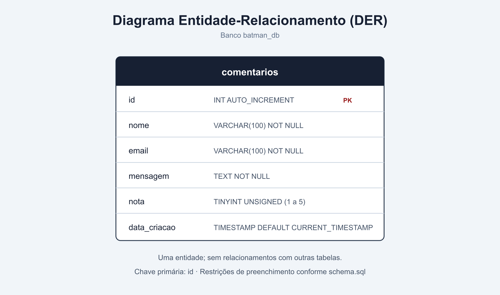
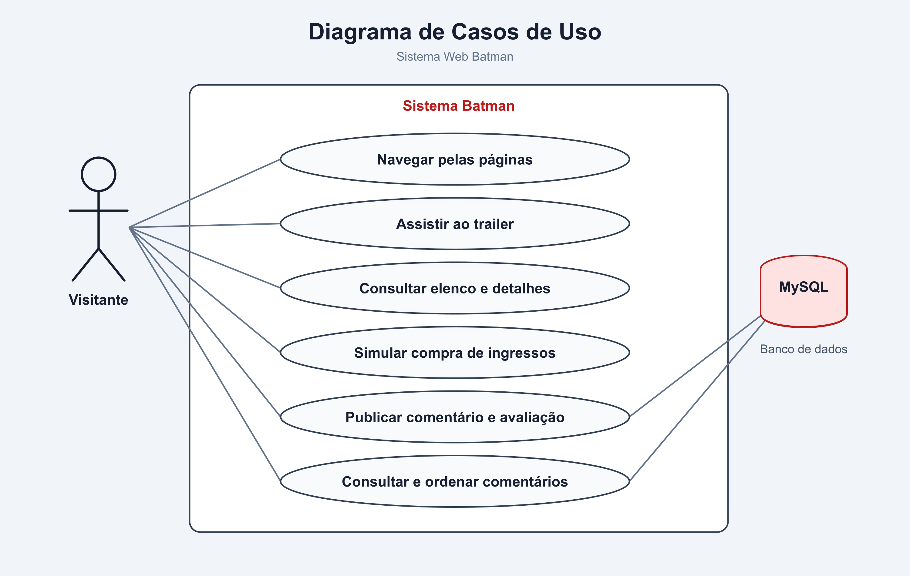
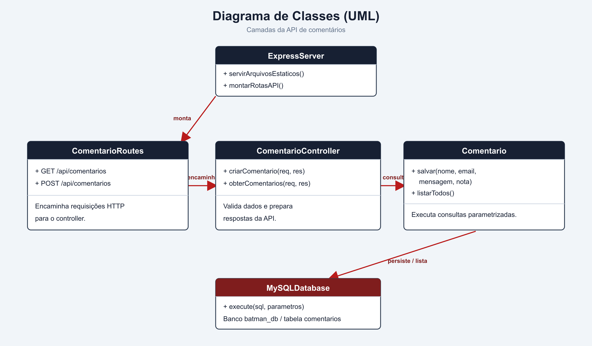
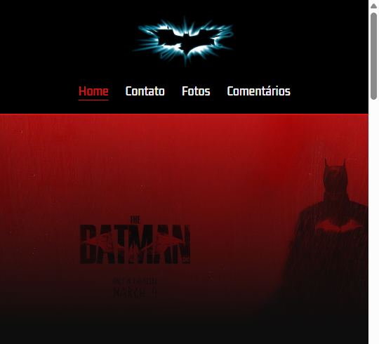
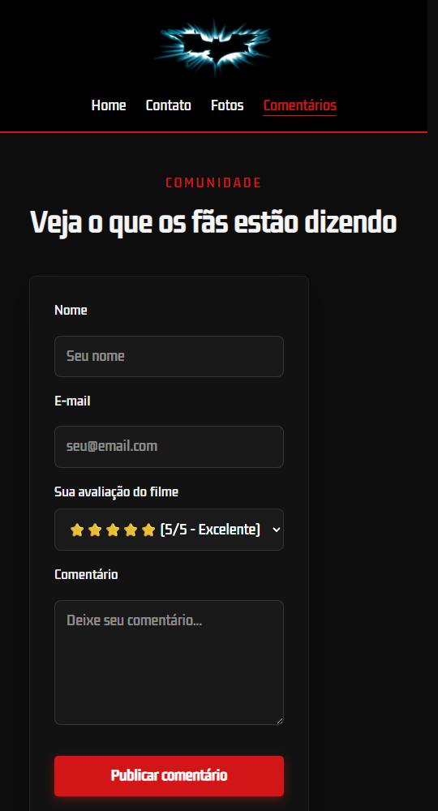
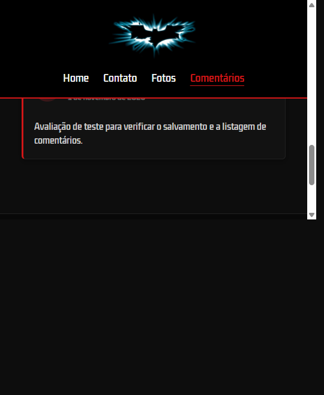
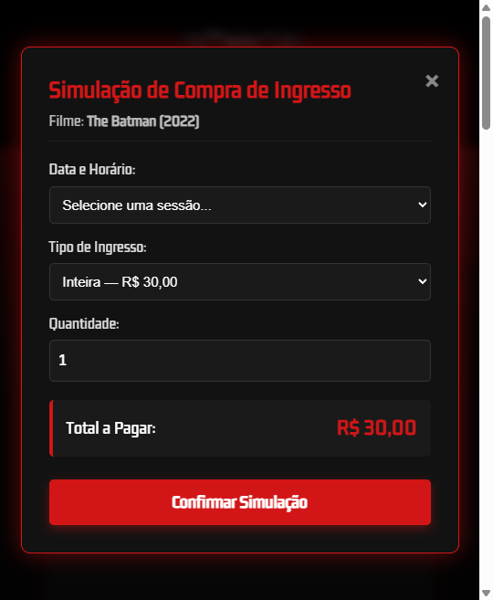
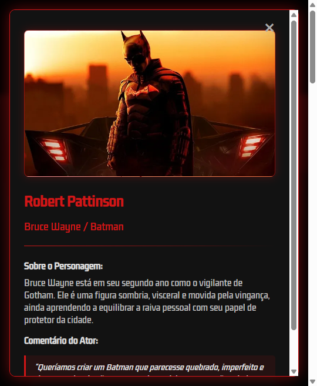

# Relatório Técnico — Projeto Integrador Transdisciplinar II (PIT II)

**Aluno:** André Martins Ribeiro<br>
**RGM:** 33639469<br>
**Curso:** Engenharia de Software | Cruzeiro do Sul Virtual<br>
**Projeto:** Aplicação Web "The Batman"

## 1. Visão Geral da Solução

Aplicação web full-stack desenvolvida em Node.js com Express e banco de dados MySQL na nuvem. A aplicação organiza a API de avaliações em rotas, controller e model, e oferece avaliações por estrelas, modais interativos do elenco e simulação de bilheteria.

- **Código-fonte:** [github.com/andremartinsadr/batman-app](https://github.com/andremartinsadr/batman-app)
- **Aplicação publicada:** [batman-app-t8gc.onrender.com/index.html](https://batman-app-t8gc.onrender.com/index.html)

A compra de ingressos é uma simulação de interface, sem cobrança ou reserva real. O site utiliza HTML, CSS e JavaScript; o servidor e a API REST usam Node.js e Express; e os comentários são persistidos em MySQL compatível com TiDB Cloud.

## 2. Modelagem de Dados (DER)

A tabela `comentarios` armazena as avaliações. A definição abaixo corresponde ao schema usado pelo projeto:

```sql
CREATE TABLE IF NOT EXISTS comentarios (
    id INT AUTO_INCREMENT PRIMARY KEY,
    nome VARCHAR(100) NOT NULL,
    email VARCHAR(100) NOT NULL,
    mensagem TEXT NOT NULL,
    nota TINYINT UNSIGNED NOT NULL,
    data_criacao TIMESTAMP DEFAULT CURRENT_TIMESTAMP
);
```

O campo `nota` aceita valores de 1 a 5 conforme a validação da aplicação. O nome da coluna de data é `data_criacao`.



*Figura 1 — Entidade `comentarios` do banco `batman_db`.*

A listagem da API não expõe o e-mail. Consulte o [schema SQL](https://github.com/andremartinsadr/batman-app/blob/main/src/config/schema.sql) e o [controller de comentários](https://github.com/andremartinsadr/batman-app/blob/main/src/controllers/ComentarioController.js).

## 3. Diagramas UML

### Diagrama de Casos de Uso

O diagrama representa as interações do visitante com a navegação, o trailer, os modais do elenco, a simulação de bilheteria e as avaliações, incluindo a integração com o banco de dados.



*Figura 2 — Casos de uso do visitante e integração com o banco de dados.*

### Diagrama de Classes

O diagrama apresenta as principais partes da API de comentários e suas responsabilidades:

- **ExpressServer** serve os arquivos estáticos e monta as rotas da API.
- **ComentarioRoutes** encaminha as requisições `GET` e `POST` para `ComentarioController`.
- **ComentarioController** valida os dados e solicita as operações ao model `Comentario`.
- **Comentario** executa consultas parametrizadas no MySQL.



*Figura 3 — Organização das camadas responsáveis pela API de comentários.*

## 4. Arquivos para Download

- [Baixar relatório completo em DOCX](Relatorio_Tecnico_Projeto_Batman.docx?raw=true)
- [Ler este relatório em Markdown no GitHub](https://github.com/andremartinsadr/batman-docs/blob/main/Relatorio_Tecnico.md)

## 5. Capturas das Telas em Execução

As imagens a seguir foram capturadas na versão pública do site, em layout responsivo. O conteúdo do player de trailer é fornecido pelo YouTube e pode variar conforme o navegador e os recursos de reprodução disponíveis.

### 5.1 Página Inicial



*Figura 4 — Cabeçalho e banner da página inicial na [aplicação publicada](https://batman-app-t8gc.onrender.com/).*

### 5.2 Formulário de Comentários



*Figura 5 — Formulário responsivo para nome, e-mail, nota e mensagem.*

### 5.3 Comentário Listado



*Figura 6 — Comentário de teste salvo e exibido na lista pública.*

Na verificação do ambiente publicado, a página confirmou o envio e apresentou a avaliação de cinco estrelas na lista da comunidade.

### 5.4 Simulação de Compra de Ingresso



*Figura 7 — Modal de compra simulada com data, tipo, quantidade e total.*

### 5.5 Detalhes do Elenco



*Figura 8 — Modal com informações do personagem e comentário do ator.*

## 6. Verificações Funcionais

- A simulação de ingressos atualizou o total para R$ 45,00 ao selecionar meia-entrada de R$ 15,00 e quantidade 3.
- Os modais dos três atores exibiram nome, personagem e fala correspondentes.
- Um comentário de teste com nota 5 foi enviado à API e apareceu na página pública, confirmando o fluxo de gravação e consulta.

Para mais detalhes sobre arquitetura, rotas e persistência, consulte a [documentação de modelagem](https://github.com/andremartinsadr/batman-docs/blob/main/docs/modelagem.md) do repositório `batman-docs`.
