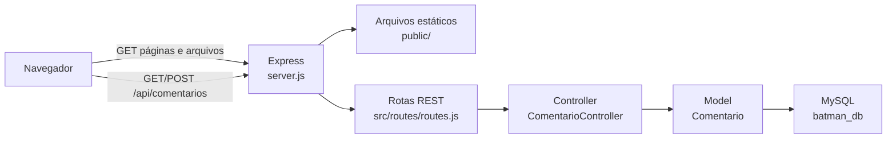
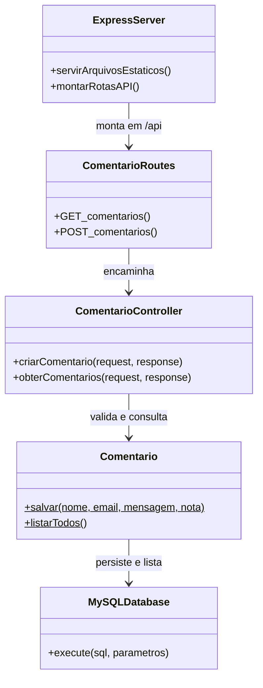
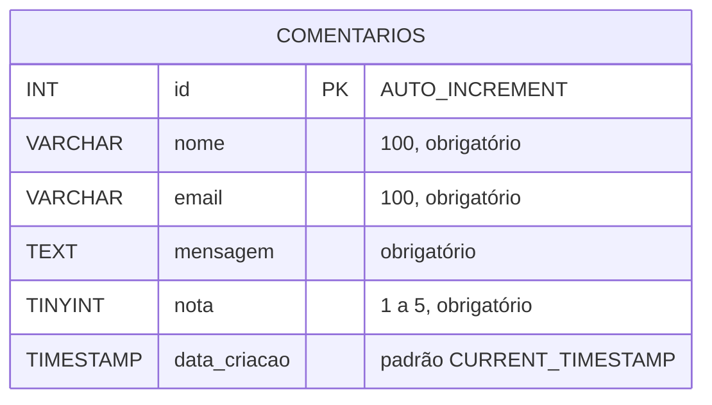

# Arquitetura e modelagem

## Arquitetura da aplicação

O navegador recebe as páginas e os arquivos estáticos servidos pelo Express. As operações de comentários usam a API REST, que encaminha as requisições ao controller, ao model e ao banco MySQL.

## Diagrama de classes (UML)

## Diagrama entidade-relacionamento (DER)

O esquema atual possui uma entidade. Cada comentário guarda nome, e-mail, mensagem, nota e data de criação. Não há relacionamentos com outras entidades.

## Regras e persistência

- O banco é `batman_db`, criado em `utf8mb4`.
- `id` é a chave primária autoincrementada.
- `nota` é um inteiro sem sinal e o controller limita o valor de 1 a 5.
- A criação grava `nome`, `email`, `mensagem` e `nota`.
- A listagem ordena por `data_criacao` e depois por `id`, ambos em ordem decrescente, e não inclui o e-mail na resposta.
- O model usa consultas parametrizadas para gravar dados.
- Para uma instalação nova, `src/config/schema.sql` é a referência do esquema atual. A migration `001-add-rating.sql` é uma alteração histórica para uma tabela anterior; não execute essa migration depois do esquema atual, pois ele já contém a coluna `nota`.
